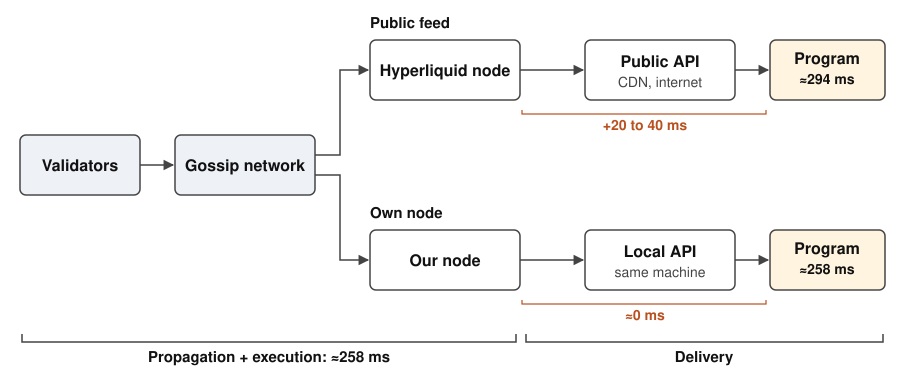
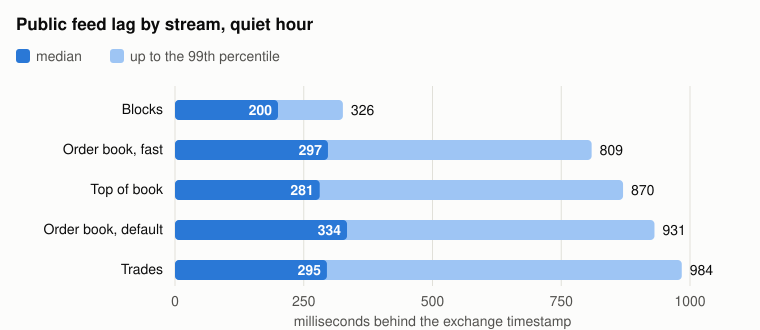
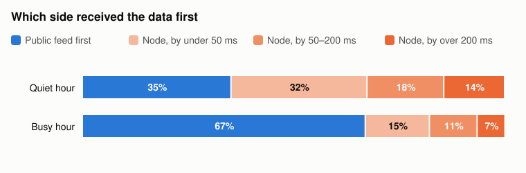
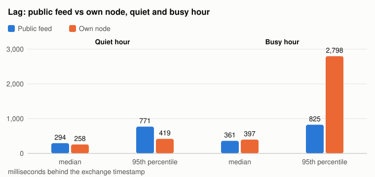
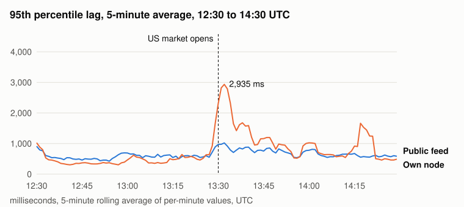
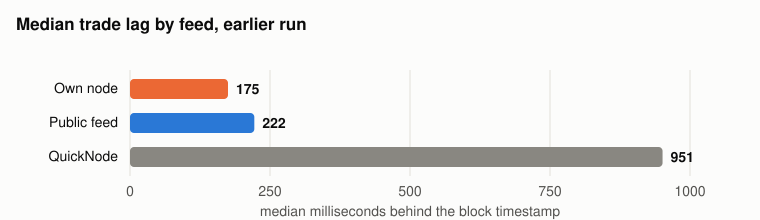

# How Hyperliquid data feed latency is measured

Author: Dean
Date: 2026-10-30

Latency is one of the critical components in a trading system. In this article, we will present a non-validator Hyperliquid node setup, and compare it with the public data feed, as well as some big data feed vendors, in several latency metrics during different market pressure situations.

## Key takeaways

- **Public feed:** BTC trades arrive 295 ms after the exchange timestamp at the median, 984 ms at the 99th percentile.
- **Own node, quiet market:** first on 65% of trades, with a 95th percentile of 419 ms against 771 ms for the public feed.
- **Own node, when the US stock market opens:** first on only 33% of trades, with a 95th percentile of 2.8 s against 0.8 s.
- **Data feed vendor:** in our earlier run, a major vendor's feed trailed the public feed by about 730 ms at the median.

## 1. The data path and where lag accrues

Validators order transactions with HyperBFT and produce a block roughly every 70 ms. Blocks travel over the gossip network, through sentries and other peers, to non-validating nodes, which execute each block and write the results (trades, fills, order statuses) as output streams ([node README](https://github.com/hyperliquid-dex/node)). The public API is fed by such a node as well, since its trades and book updates are execution results.

A trade's lag, from its exchange timestamp to the moment a program has it, builds up in three stages. Figure 1 gives each stage's share for BTC trades in our quiet hour, at the median:

- **Propagation and execution (stages 1 and 2):** the block travels from the proposing validator to the node, and the node executes it. Together these took 258 ms on our node, and 397 ms in the hour after the US stock market opened. Our data can't separate the two.
- **Delivery (stage 3):** an API service passes the trade from the node to the program. On our node it runs on the same machine and adds next to nothing. On the public side, the API service, CloudFront and the internet add an estimated 20 to 40 ms: the public feed's median was 294 ms against our node's 258 ms, and per trade the public copy arrived a median 20 ms after the node's. The estimate assumes the API's node propagates and executes as fast as ours.

Most of the lag is spent before any API is involved. Running your own node removes the CDN and internet hop, worth tens of milliseconds; the larger first part depends on the node's peers and machine, and when the US stock market opened it cost our node up to about 3 seconds.



*Figure 1. Where lag accrues between the validators and a program, for BTC trades in the quiet hour, at the median. Propagation and execution are measured together on our node; public delivery is estimated; the local API hop is assumed negligible. Source: node README (gossip, sentries, API servers); response headers observed 2026-10-29 (CloudFront).*

## 2. How we measured

**Public feed.** A collector on the same host as our node (setup at the end of the article) subscribed to the public streams (`explorerBlock`, `trades`, `bbo` and `l2Book`, with and without the `fast` option) and stamped every message with the host's clock on arrival. The clock was synced with chrony to the Amazon time service.

**Node against public feed.** The comparisons in Figures 3 to 5 use BTC trades, because a trade carries a unique hash on both sides and can be matched one to one. We matched each BTC trade in the node's trade stream with the same trade on the public `trades` stream, by transaction hash, price and size, and compared the node's write time with the collector's receive time. Both are on one clock, so no synchronization between machines is involved. We assume our node serves trades through a local API service in the public feed's format, on the same machine, and treat that local hop as negligible.

**Metrics.** Lag is arrival time minus the exchange timestamp on the message (block time for blocks, trade time for trades). We report the median, the 95th percentile (one message in twenty is slower), the 99th (one in a hundred) and, for the node, the share of trades it received first. For a trading system, the tail matters more than the median.

**Market conditions.** Two hours on 2026-10-29: a quiet Tokyo evening, 10:33 to 11:33 UTC, and the hour after the US stock market opened, 13:30 to 14:30 UTC (9:30 in New York), when trading on Hyperliquid jumps. We call these the quiet hour and the busy hour.

## 3. Results

### 3.1 The public feed from Tokyo



*Figure 2. Lag of the public feed from Tokyo by stream, quiet hour (10:33 to 11:33 UTC, 2026-10-29). Darker bar: median; lighter bar: up to the 99th percentile.*

Blocks arrive about 200 ms after their timestamp at the median, and even the slowest 1% arrive within 326 ms. Trades, top of book and order book updates arrive later, around 300 ms at the median, and their slowest 1% take 0.8 to 1 second. The order book has a `fast` option: it sends 5 price levels per side about every 0.5 s instead of 20 levels about every 5 s, and arrives slightly sooner (99th percentile 809 ms against 931 ms).

### 3.2 Own node against the public feed



*Figure 3. Share of BTC trades that reached the public feed first or the node first, and by how much. Source: our collector and node, same host and clock, 2026-10-29; 6,194 matched trades in the quiet hour, 15,636 in the busy hour.*

In the quiet hour the node had the trade first 65% of the time. Most of those wins were small: a typical trade reached the node 20 ms before the public feed. But on one trade in seven the node was ahead by more than 200 ms, which is where it pays off. In the busy hour the picture flipped: the public feed was first on 67% of trades.



*Figure 4. Median and 95th percentile lag of BTC trades, public feed against own node. Source: as Figure 3.*

The same split shows in the lag itself. In the quiet hour the node's 95th percentile was 419 ms against 771 ms for the public feed. In the busy hour it was 2,798 ms against 825 ms, while the public feed slowed only a little: BTC trades went from 295 to 358 ms at the median, and blocks from 200 to 234 ms.

### 3.3 What happened when the US market opened



*Figure 5. 95th percentile lag of BTC trades, computed per minute and smoothed with a 5-minute rolling average, 12:30 to 14:30 UTC on 2026-10-29. Source: our node's trade stream and our collector, same host and clock.*

The node's delay was concentrated at the open. Its median lag on BTC trades went from 267 ms at 13:29 to 2,839 ms at 13:31 and 3,236 ms at 13:32, and was back under 600 ms by 13:34; the public feed's median peaked at 607 ms. For the rest of the hour the node stayed less steady than before: its 95th percentile was above the public feed's in 37 of the busy hour's 60 minutes, against 14 of 60 in the hour before the open, with short spikes such as 4.2 s at 14:19. Leaving out the first five minutes doesn't change the hour's result: from 13:35 to 14:30 the node was first on 37% of trades.

In the terms of section 1, the extra delay came from propagation or execution on our node: blocks arriving late through its single sentry, or heavier blocks executing on 16 vCPU, half the 32 logical cores [Hyperliquid's latency guide](https://hyperliquid.gitbook.io/hyperliquid-docs/for-developers/api/optimizing-latency) recommends.

### 3.4 Against data feed vendors



*Figure 6. Median trade lag by feed. Source: our earlier run, 2026-07-04, AWS Tokyo, one clock; node read through an order book server.*

We ran an earlier comparison on 2026-07-04, also from AWS Tokyo and on one clock, that included QuickNode's WebSocket feed. There the node led the public feed by a median 28 ms and was first on 87% of trades, much like our quiet hour. QuickNode's feed trailed both by most of a second: 951 ms at the median against 222 ms for the public feed, and it was behind the node on every trade, by a median 754 ms.

### 3.5 What the node cost to run

| Item | Per hour | Per month |
| --- | ---: | ---: |
| Instance (`r6i.4xlarge`) | $1.22 | $888 |
| Disk (1 TB gp3) | $0.18 | $132 |
| Public IP address | $0.005 | $4 |
| Bandwidth, per peer streaming from your node | $0.59 | $427 |
| **Total, no peers** | **$1.40** | **$1,024** |
| **Total, 8 peers** | **$6.12** | **$3,946** |

*AWS Tokyo on-demand prices, October 2026. Bandwidth gets cheaper after 10 TB a month, so the 8-peer total is less than eight times the per-peer line.*

- **Bandwidth:** other nodes can stream blocks from yours, and each one costs you about 5 GB of outbound traffic an hour. With the gossip ports open, as Hyperliquid requires, one of our nodes picked up 7 to 10 such peers and sent about 43 GB an hour.
- **Machine:** it used 3 to 7 of its 16 vCPU and 25 to 48 GB of its 128 GB.
- **Disk:** it grew 32 to 41 GB an hour, so 1 TB lasts about a day without a cleanup job.

## Our node setup

- **Machine:** AWS `r6i.4xlarge` in Tokyo (ap-northeast-1, zone ID apne1-az1), 16 vCPU, 128 GiB of memory, 1 TB gp3 volume at 6,000 IOPS and 500 MiB/s, Ubuntu 24.04.
- **Software:** `hl-node` build 28076c1 (2026-10-25) under `hl-visor` c6b742f (2026-09-09), run as a systemd service:

  ```bash
  ~/hl-visor run-non-validator --write-trades --stream-with-block-info --disable-output-file-buffering
  ```

  These flags make the node write every trade to a local file as soon as it is executed, with the node's own timestamp.
- **Peer:** one open sentry.
- **API service:** a local WebSocket service on the same machine, serving trades in the public feed's format (assumed; its local hop is treated as negligible).
- **Collector:** on the same host, unauthenticated public WebSocket streams (`explorerBlock` on `rpc.hyperliquid.xyz`; `trades`, `bbo` and `l2Book` on `api.hyperliquid.xyz`), one connection per stream, clock synced with chrony to the Amazon time service.
