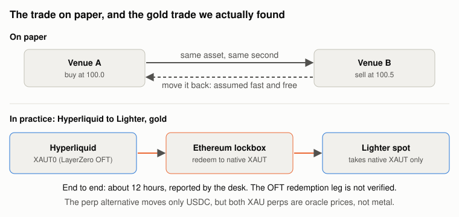
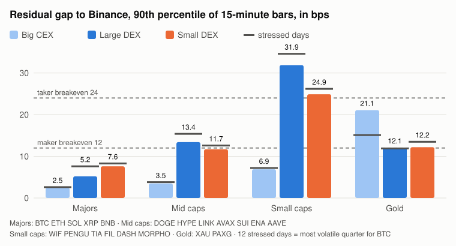
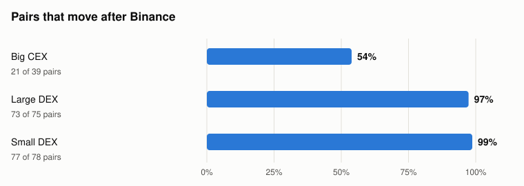
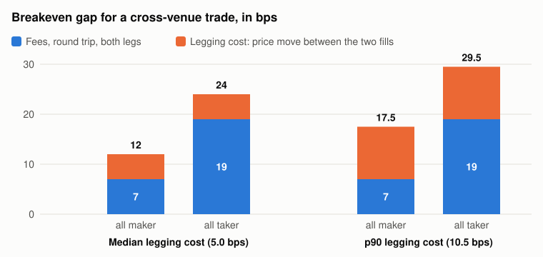

# Arbitrage in reality, part 1: one coin, twelve venues

Author: Hung P.
Date: 2026-11-08 (draft)

This series takes well-known arbitrage trades one at a time and checks each one against what we measured. Part 1 is the simplest: the same perpetual future listed on two venues at two prices.

## Key takeaways

We tested cross-exchange arbitrage on 11 exchanges against Binance, across 20 coins over 50 days, and found it is rarely profitable. On the biggest coins, prices stayed within about 0.08% of Binance's 90% of the time, even during the November sell-offs, while trading the gap costs at least 0.12%. Some small coins showed bigger gaps, but these come partly from how we measured them and are unlikely to be tradeable in practice.

## 1. The trade on paper

Buy on the cheap venue, sell on the rich one, wait for the prices to converge, unwind both legs and keep the difference. It assumes four things: the two venues list the same asset, the prices converge, the gap is larger than the cost of trading it, and nobody else closes it first.

*Figure 1. Top: the trade on paper. Bottom: the gold route from Hyperliquid to Lighter spot. Source: our venue sheet, 28 Aug 2026; desk report, 3 Sep 2026 (transfer time not verified by us).*

## 2. How we measured

**Venues.** Binance USDT-M perps as the reference, plus 11 venues chosen to be established and active, not ones at risk of closing:

| Group | Venues | Quote |
| --- | --- | --- |
| Big CEX | Bybit, OKX | USDT |
| Large DEX | Hyperliquid, Lighter, Aster, dYdX | USDC, USDT |
| Small DEX | GRVT, Orderly, Extended, Pacifica, ApeX | USDC, USDT, USD |

**Assets.** 20 in four tiers: majors (BTC, ETH, SOL, XRP, BNB), mid caps (DOGE, HYPE, LINK, AVAX, SUI, ENA, AAVE), small caps (WIF, PENGU, TIA, FIL, DASH, MORPHO) and gold (XAU, PAXG). 192 venue–asset pairs had data.

**Windows.** The main window is 15-minute closes from 19 Sep to 8 Nov 2026, 50 days. Hourly closes over 61 days, from 8 Sep, gave figures within 3 bps of it. We used 1-minute closes from 3 to 6 Nov to see which venue moves first, and hourly closes from 22 to 26 Aug, the days after Lighter listed gold, for the gold pairs.

**Quiet and stressed days.** We ranked the days by Binance BTC's realised volatility. The 12 most volatile, a quarter of the window, are the stressed days; they include the sell-offs of 4 and 5 Nov. BTC's daily volatility was 2.1% to 3.2% on those days, against 0.4% to 1.6% on the calmest half.

**Metrics.** The gap is the venue's price over Binance's, minus one, in bps (1 bp = 0.01%). Part of it is a static offset, from quoting in USDC rather than USDT or tracking a different index, that never closes and cannot be traded. We take the median gap of each pair as its offset and report what is left, the residual, at its 90th percentile: one bar in ten is wider. Figures for a group are the median across its pairs. On dYdX we use the order-book mid. Elsewhere the close is the last trade, so a bar with no trade repeats an older price and overstates the gap. We checked each venue's bar timestamps against Binance's; all of them line up.

## 3. Results

### 3.1 The gaps are a few bps, except on thin books

*Figure 2. 90th percentile of the residual gap to Binance, by venue group and asset tier, 15-minute closes, 19 Sep to 8 Nov 2026. The dark marks show the same figure on the 12 stressed days. Source: public candle APIs of each venue.*

Majors stayed under the maker breakeven (12 bps; see section 4) on every venue group, on quiet and stressed days alike. Mid caps on the DEXs were near it (13.4 and 11.7 bps). Small caps crossed the taker breakeven (24 bps) on both DEX groups, at 31.9 and 24.9 bps.

Volatility moved these figures less than we expected. On stressed days the large DEXs' majors went from 5.2 to 7.6 bps, the most of any group; Bybit and OKX barely moved. At group level the gaps depend on venue and asset more than on the day, though single venues moved more: dYdX went from 28.4 to 44.7 bps between quiet and stressed days.

Thin books explain part of the small-cap gaps. In early November no trade printed in 38% of minutes on Lighter and 49% on Aster. A bar with no trade shows an old price, so part of the gap is a stale print, not an order anyone could fill. Counting only minutes with trades, Lighter's median residual fell from 5.0 to 3.5 bps. They don't explain dYdX, where we use the mid and the gaps were widest.

| Venue | Static offset | Residual p90 | Bars above 24 bps | p90, quiet days | p90, stressed days |
| --- | ---: | ---: | ---: | ---: | ---: |
| Bybit | −0.8 | 3.6 | 0% | 4.0 | 4.5 |
| OKX | 0.0 | 3.3 | 0% | 3.7 | 3.8 |
| Hyperliquid | 2.3 | 10.1 | 0% | 8.9 | 11.2 |
| Lighter | 1.8 | 16.2 | 4% | 14.7 | 18.4 |
| Aster | 1.3 | 13.4 | 1% | 13.9 | 13.8 |
| dYdX | 0.2 | 36.3 | 16% | 28.4 | 44.7 |
| GRVT | 1.0 | 22.0 | 8% | 19.1 | 26.3 |
| Orderly | −7.4 | 8.3 | 0% | 8.1 | 8.3 |
| Extended | −8.2 | 11.7 | 0% | 10.1 | 12.5 |
| Pacifica | 1.7 | 6.0 | 0% | 6.1 | 6.5 |
| ApeX | 0.0 | 13.7 | 1% | 13.3 | 14.3 |

*Median across each venue's assets, in bps, 15-minute closes, 19 Sep to 8 Nov 2026. Quiet days are the calmest half. Pacifica returned 15-minute history for 4 of its assets, dYdX lists 15 of the 20.*

### 3.2 Lead–lag: Binance leads, the rest catch up within a minute

*Figure 3. Share of venue–asset pairs that lag Binance: their 1-minute returns correlate more with Binance's earlier returns than the reverse, 3 to 6 Nov 2026. Source: as Figure 2.*

Measured on candle closes, 73 of 75 pairs on the large DEXs moved after Binance, and 77 of 78 on the small DEXs. The link was strongest at one minute in 152 of 192 pairs, and the residual had a median half-life of 1 to 2 minutes. Bybit and OKX were the exception: about half their pairs led and half followed, with almost no correlation either way, because they move at the same time as Binance.

The lag was largest on dYdX, GRVT and ApeX: their 1-minute returns had a correlation of 0.54 to 0.77 with Binance's return one minute earlier. Part of this may come from how we measured prices rather than from the market.

We can't see who sets these prices, only the footprint: DEX prices catch up with Binance within a minute or two, on large and small venues alike. Market makers quoting off Binance would leave this footprint, but so would any trader who watches Binance first.

### 3.3 Static offsets look like gaps but never close

Extended sat a median 8.2 bps below Binance and Orderly 7.4 bps below, across their assets. Both quote in USD or USDC against Binance's USDT, so part of the offset is the exchange rate between the two, but not all: Hyperliquid, Lighter and dYdX also quote in USDC and sat 0.2 to 2.3 bps above Binance. Bybit and OKX, which quote in USDT, were within 1 bp. Gold showed the same thing at a larger size: in early November the XAU perp on 8 of 9 venues sat 36 to 53 bps from Binance's, which follows a different reference price. Because that reference drifts, part of the drift is left in the residual: 21 bps for gold on Bybit and OKX in Figure 2.

### 3.4 Gold, August

| Pair, Hyperliquid vs Lighter | Median | Max | Hours above 24 bps, of 96 | Longest run above 12 bps |
| --- | ---: | ---: | ---: | ---: |
| Gold perp vs gold perp | 5.6 | 10.7 | 0 | 0 h |
| XAUT0 token vs XAUT token | 21.0 | 78.4 | 39 | 35 h |

*Hourly closes, 22 to 26 Aug 2026, in bps, the two venues compared directly. Source: both venues' public candle APIs.*

In late August we saw a gold gap between Hyperliquid and Lighter. The two gold perps tracked each other within 11 bps for four days; the gap was between two forms of the gold token. Hyperliquid holds XAUT0, a LayerZero OFT; Lighter takes only native XAUT on Ethereum. Moving one into the other through the Ethereum lockbox took about 12 hours, according to our desk; we have not verified it.

## 4. The breakeven gap

*Figure 4. Breakeven gap for a cross-venue round trip: fees on both legs plus legging cost, the price move between the first fill and the second. Fees exclude the bid–ask spread a taker pays. Legging cost measured between two venues from 1-minute closes on 8 coins, July 2026.*

A cross-venue round trip has to clear at least 12 bps with maker orders and 24 bps with taker orders, plus the spread for takers, and up to 29.5 bps with heavy slippage on the second leg. Against that breakeven:

- **Majors:** below the maker breakeven on every venue group, on stressed days too.
- **Small caps on DEXs:** above the taker breakeven in 10% to 20% of bars, on books where a third to a half of minutes print no trade.
- **Speed:** the residual's half-life is 1 to 2 minutes in 1-minute data, so we can't tell how fast it really closes; our one-way order latency to Hyperliquid is about 0.5 seconds.

## 5. The series

Plain cross-venue arbitrage on the same perp was rarely profitable on the venues we tested, in quiet weeks and in sell-offs: the gaps are smaller than the cost, and the ones that are larger sit on books too thin to fill. The next parts look at trades where the spread is not expected to converge on its own.

| Part | Arbitrage | Question |
| --- | --- | --- |
| 1 | Same perp, two venues | This article |
| 2 | Spot vs perp (basis) | Does the basis close, and what does holding it cost? |
| 3 | Funding-rate carry | Does a backtest at 9% a year survive live fills? |
| 4 | Dated futures vs perp | How often is quarterly basis worth the capital? |
| 5 | On-chain AMM and triangular | Is anything left after MEV searchers? |
| 6 | Oracle-priced pools | Can oracle lag be traded on GMX-style venues? |

## Data

| Venue | Candles | Price used |
| --- | --- | --- |
| Binance, Aster | `/fapi/v1/klines` | last trade |
| Bybit | `/v5/market/kline` | last trade |
| OKX | `/api/v5/market/history-candles` | last trade |
| Hyperliquid | `candleSnapshot` | last trade |
| Lighter | `/api/v1/candles` | last trade |
| dYdX | indexer `/v4/candles` | order-book mid |
| GRVT | `/full/v1/kline` | last trade |
| Orderly | `/tv/history` | last trade |
| Extended | `/api/v1/info/candles` | last trade |
| Pacifica | `/api/v1/kline` | last trade |
| ApeX | `/api/v3/klines` | last trade |

Hyperliquid keeps the latest 5,000 candles per interval, which limits 1-minute data to about 3.5 days and 15-minute data to about 52.

## Sources

- Our measurements from the venues above: 15-minute closes 19 Sep to 8 Nov 2026, hourly closes 8 Sep to 8 Nov 2026, 1-minute closes 3 to 6 Nov 2026, hourly closes 22 to 26 Aug 2026.
- Venue sheet `categorized_exchanges`, 28 Aug 2026: transfer routes and rails.
- Internal research notes, July 2026: order latency, legging cost, fees.
- [Article 001: How Hyperliquid data feed latency is measured](../001-hyperliquid-data-feed-latency/README.md).
