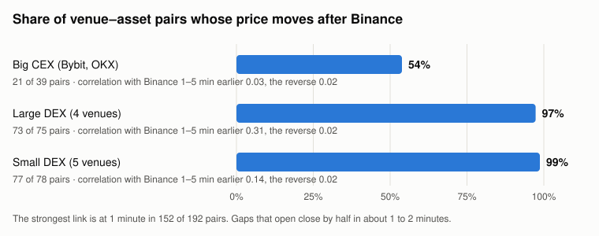

# Arbitrage in reality, part 1: one coin, twelve venues

Author: Hung P.
Date: 2026-11-06 (draft)

This series takes well-known arbitrage trades one at a time and checks each one against what we measured. Part 1 is the simplest: the same perpetual future listed on two venues at two prices. We compared 11 venues, large and small, against Binance across 20 assets, minute by minute, to see whether the gaps are there and whether anything can be done with them.

## Key takeaways

- **Majors:** in the worst 10% of minutes, BTC, ETH, SOL, XRP and BNB sat 2 to 5 bps from Binance, depending on the venue group. A round trip costs 12 bps with maker orders and 24 bps with taker orders.
- **Who keeps them together:** on 150 of 153 DEX venue–asset pairs, the price moved after Binance, usually one minute later. A gap that opened lost half its size in about 1 to 2 minutes.
- **Where gaps survive:** small caps on large DEXs, at 29.9 bps in the worst 10% of minutes. Those books traded in only 51% to 62% of minutes.
- **Gold:** in August the Hyperliquid and Lighter gold perps never differed by more than 11 bps. The gap we had seen was between two gold tokens, XAUT0 and XAUT, and moving one into the other took about 12 hours.

## 1. The trade on paper

Buy on the cheaper venue, sell on the dearer one, wait for the prices to meet, close both sides and keep the difference. It assumes four things: the two venues list the same asset, the prices meet, the gap is larger than the cost of trading it, and nobody else closes it first.

*Figure 1. Top: the trade on paper. Bottom: the gold route from Hyperliquid to Lighter spot. Source: our venue sheet, 28 Aug 2026; desk report, 3 Sep 2026.*

## 2. How we measured

**Venues.** Binance USDT-M perps as the reference, plus 11 venues chosen to be established and active, not ones at risk of closing:

| Group | Venues | Quote |
| --- | --- | --- |
| Big CEX | Bybit, OKX | USDT |
| Large DEX | Hyperliquid, Lighter, Aster, dYdX | USDC, USDT |
| Small DEX | GRVT, Orderly, Extended, Pacifica, ApeX | USDC, USDT, USD |

**Assets.** 20 in four tiers: majors (BTC, ETH, SOL, XRP, BNB), mid caps (DOGE, HYPE, LINK, AVAX, SUI, ENA, AAVE), small caps (WIF, PENGU, TIA, FIL, DASH, MORPHO) and gold (XAU, PAXG). 192 venue–asset pairs had data.

**Windows.** 1-minute closes from 3 to 6 Nov 2026, and hourly closes from 22 to 26 Aug 2026, the days after Lighter listed gold.

**Metrics.** The gap is the venue's price over Binance's, minus one, in bps. Part of it is a steady offset, from quoting in USDC rather than USDT or tracking a different index, that never closes and cannot be traded. We take the median gap of each pair as its offset and report what is left, the residual. We also report how fast a residual halves (half-life), and whether the venue's price moves after Binance's (the correlation of its 1-minute returns with Binance's 1 to 5 minutes earlier, against the reverse). On dYdX we use the order-book mid; elsewhere the close is the last trade, so a minute with no trades repeats an older price.

## 3. Results

### 3.1 The gaps are a few bps, except on thin books

*Figure 2. 90th percentile of the residual gap to Binance, by venue group and asset tier, 1-minute closes, 3 to 6 Nov 2026. Source: public candle APIs of each venue.*

On majors, nine minutes in ten were within 2.2 bps of Binance on Bybit and OKX, 3.6 bps on the large DEXs and 5.0 bps on the small ones. Three cells crossed the maker hurdle: mid caps on large DEXs (14.5 bps), gold on Bybit and OKX (17.5 bps) and small caps on large DEXs. Only the last crossed the taker hurdle, at 29.9 bps.

That cell is where the books are thinnest. On Lighter, 38% of minutes had no trade at all; on Aster, 49%. A minute with no trade shows an old price, so part of the gap is a stale print, not an order anyone could fill. Counting only minutes with trades, Lighter's median residual fell from 5.0 to 3.5 bps.

| Venue | Steady offset | Residual, median | Minutes above 24 bps | Minutes with trades |
| --- | ---: | ---: | ---: | ---: |
| Bybit | −1.8 | 1.4 | 0% | 100% |
| OKX | −1.3 | 1.2 | 0% | 100% |
| Hyperliquid | 0.7 | 2.9 | 0% | 98% |
| Lighter | 1.2 | 5.0 | 3% | 62% |
| Aster | 1.0 | 5.2 | 1% | 51% |
| dYdX | 0.0 | 6.5 | 6% | mid price |
| GRVT | 0.6 | 7.0 | 9% | 30% |
| Orderly | −9.1 | 2.3 | 0% | 6% |
| Extended | −11.2 | 1.4 | 0% | not reported |
| Pacifica | −0.1 | 1.7 | 0% | 100% |
| ApeX | 0.1 | 6.9 | 1% | 50% |

*Median across each venue's assets, in bps, 1-minute closes, 3 to 6 Nov 2026. Pacifica lists 4 of the 20 assets.*

### 3.2 Someone quotes them off Binance

*Figure 3. Share of venue–asset pairs whose 1-minute returns follow Binance's more than Binance's follow theirs. Source: as Figure 2.*

On the large DEXs, 73 of 75 pairs moved after Binance; on the small DEXs, 77 of 78. The link was strongest at one minute in 152 of 192 pairs, and a residual gap halved in a median of 1 to 2 minutes. Bybit and OKX were the exception: about half their pairs led and half followed, with almost no correlation either way, because they move at the same time as Binance.

We can't see who is quoting, only the footprint: DEX prices are reset to Binance within a minute or two, on large and small venues alike. Small DEXs on mid and small caps were tighter than the large DEXs (8.1 against 14.5 bps, and 7.7 against 29.9), which fits a few market makers quoting their books off Binance rather than independent traders setting the price.

### 3.3 Steady offsets look like gaps but never close

Extended sat a median 11.2 bps below Binance and Orderly 9.1 bps below, across their assets. Both quote in USD or USDC against Binance's USDT, so the offset is the exchange rate between the two, not a mispricing. Gold showed the same thing at a larger size: on 8 of 9 venues the XAU perp sat 36 to 53 bps from Binance's, because the venues track a different gold price. Once that offset is removed, the residual was 6 to 8 bps.

### 3.4 Gold, August

| Pair, Hyperliquid vs Lighter | Median | Max | Hours above 24 bps, of 96 | Longest run above 12 bps |
| --- | ---: | ---: | ---: | ---: |
| Gold perp vs gold perp | 5.6 | 10.7 | 0 | 0 h |
| XAUT0 token vs XAUT token | 21.0 | 78.4 | 39 | 35 h |

*Hourly closes, 22 to 26 Aug 2026, in bps. Source: both venues' public candle APIs.*

The two gold perps tracked each other within 11 bps for four days. The gap that looked like an opportunity was between two forms of the gold token. Hyperliquid holds XAUT0, a LayerZero token; Lighter takes only native XAUT on Ethereum. Moving one into the other through the Ethereum lockbox took about 12 hours.

## 4. What a gap has to clear

*Figure 4. Minimum gap for a cross-venue round trip: fees on both legs plus leg-in, the price move between the first fill and the second. Leg-in measured between two venues from 1-minute closes on 8 coins, July 2026.*

A cross-venue round trip has to clear 12 bps with maker orders and 24 bps with taker orders, and up to 29.5 bps when the second leg fills badly. Against that hurdle:

- **Majors and mid caps:** the worst 10% of minutes stayed below the maker hurdle on every venue group but one.
- **Small caps on large DEXs:** above the taker hurdle in 16% of minutes, on venues where 38% to 49% of minutes had no trade.
- **Speed:** a gap halves in 1 to 2 minutes, and our order path to Hyperliquid takes about 0.5 seconds one way. Whoever quotes these books off Binance is there before us.

## 5. The series

Plain cross-venue arbitrage on the same perp is closed on the venues we tested: the gaps are smaller than the cost, and the ones that are larger sit on books too thin to fill. The next parts look at trades where the price gap is not supposed to close by itself.

| Part | Arbitrage | Question |
| --- | --- | --- |
| 1 | Same perp, two venues | This article |
| 2 | Spot vs perp (basis) | Does the basis close, and what does holding it cost? |
| 3 | Funding-rate carry | Does a backtest at 9% a year survive live fills? |
| 4 | Dated futures vs perp | How often is quarterly basis worth the capital? |
| 5 | On-chain AMM and triangular | Is anything left after MEV searchers? |
| 6 | Oracle-priced pools | Can oracle lag be traded on GMX-style venues? |

## Sources

- Our measurements: public candle APIs of Binance, Bybit, OKX, Hyperliquid, Lighter, Aster, dYdX, GRVT, Orderly, Extended, Pacifica and ApeX; 1-minute closes 3 to 6 Nov 2026 and hourly closes 22 to 26 Aug 2026.
- Venue sheet `categorized_exchanges`, 28 Aug 2026: transfer routes and rails.
- Internal research notes, July 2026: order path latency, leg-in measurement, fees.
- [Article 001: How Hyperliquid data feed latency is measured](../001-hyperliquid-data-feed-latency/README.md).
