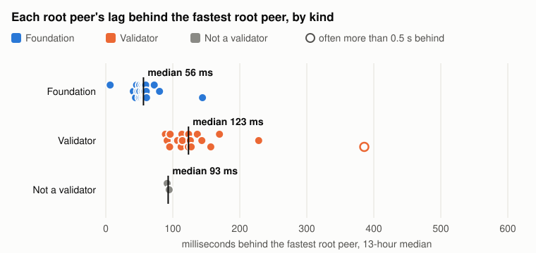
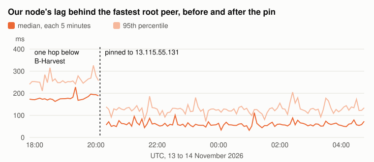
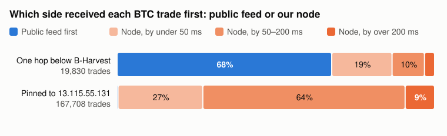
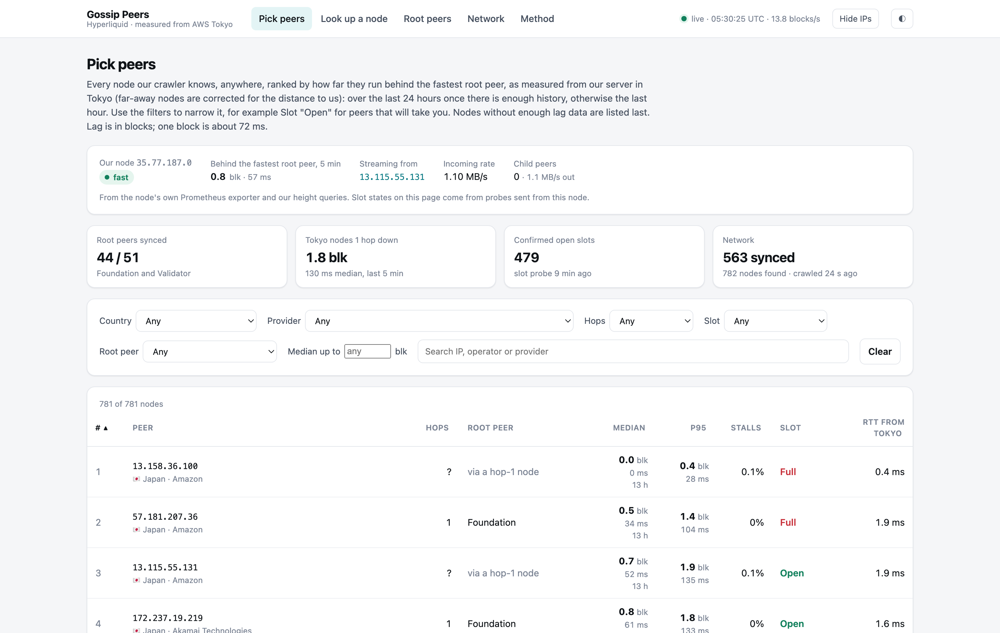

# How peer choice affects a Hyperliquid node's latency

Author: Dean N.
Date: 2026-11-14

In article 001 we ran our own non-validator Hyperliquid node and compared it with the public data feed. The hardest part of that work was getting the node connected. Left to find peers on its own, from the API's root peer list with `try_new_peers` on, it made 174 connection attempts in 27 minutes, most of them answered with `Peer full`, and it took 49 minutes in all to catch up. In the end we pinned it to one peer from the README's list, without knowing whether that was a good choice or a lucky one.

This time we looked at the peering itself. We wrote a crawler for the gossip network and turned it into an internal service that measures, every ten seconds, how far each node it can reach runs behind the root peers. We picked one peer for our node from that history. Over the next 8.5 hours our node received 99.7% of BTC trades before the public feed, 79 ms earlier at the median.

## Key takeaways

- **Hops:** in Tokyo, nodes one hop below a root peer ran a median 85 ms, about one block, behind the root peers in Tokyo. Further down, hops added little: 155 ms at two hops and 156 ms at three, against 145 ms at one. The spread between nodes at the same hop was much wider than the difference between hops.
- **Root peers:** the Foundation nodes ran a median 67 ms, about one block, ahead of the root peers run by validators.
- **Picking a peer:** one hop below a Validator root peer in South Korea, our node ran 175 ms behind the fastest root peer and was 30 ms behind the public feed at the median. Pinned to a peer chosen from the lag history, it ran 57 ms behind the fastest root peer, ahead of 31 of the 44 root peers, and beat the public feed on 99.7% of BTC trades.

## 1. How a node finds its peers

Hyperliquid's network has validators, which run consensus, and non-validator nodes, which follow the chain. Validators keep other nodes at a distance: each connects directly to at most two non-validator nodes of its own, its sentry nodes. Non-validators start from published root peers instead: Foundation nodes, which the API returns for `gossipRootIps`, and nodes run by validators, listed in the node README. Every other non-validator node, like ours, gets its blocks through them.

A non-validator node starts from a list of seed peers, `root_node_ips` in `override_gossip_config.json`. It asks each one for its status on port 4002 and tries to open a block stream on port 4001. We call the peer a node streams blocks from its parent peer, and the nodes it streams to its child peers, as the node's own status files do. A peer only takes a limited number of child peers, and when it has no free slot it replies `Peer full`. If `try_new_peers` is on, the node then asks that peer for its child peers and tries those next. It keeps walking down the tree this way until a peer accepts it.

Our crawler does the same walk, using two requests on port 4002 (described in the appendix). We started it from all 51 published root peers: the 26 Foundation nodes from the API and the 25 root peers in the community table of the node README, which pairs each IP with an operator. 21 of those 25 belong to operators that are current validators; we call them Validator root peers. The other 4 belong to two operators that are no longer validators. It found 775 nodes. Almost every root peer was already full. 44 of the 45 that answered had 7 or more child peers. Eight looks like the default limit: it was the most common number of child peers after zero, with 149 of the 650 nodes that answered, but 50 nodes had more, mostly 9 to 21 and two with 100, so the limit can be raised.

Every block a node applies has been forwarded by each node above it, so the next question was how much each hop costs.

## 2. How much each hop costs

The crawler now runs as a small service in Tokyo (Section 4). It crawls the network every two minutes, and every ten seconds it asks every node for its latest block height at the same moment. We measure each node's lag behind the fastest root peer, in blocks, and convert it at the chain's rate of about 14 blocks a second, so one block is about 71 ms. The numbers in this section are each node's median over 13 hours, from 16:15 UTC on 13 November to 05:10 UTC on 14 November. The appendix has the details.

*Figure 1. Each dot is one node in Tokyo (one our machine reached in under 5 ms): its median lag behind the fastest root peer over 13 hours, grouped by hops below a root peer. Black lines are group medians. Hops are counted only through parents that are not more than one block behind the node; "unplaced" nodes have no such parent in our crawl. Nodes synced for less than half the window are left out. Source: our gossip service, 10-second height samples, 16:15 UTC 13 November to 05:10 UTC 14 November 2026; 272 nodes.*

Counting hops takes some care. A node can only stream live blocks from a parent that is at least as far along as itself, yet some nodes are listed only under parents that are behind them. Their real parent is one our crawler cannot see, so we leave their hop count open and show them as unplaced.

The root peers in Tokyo ran a median 60 ms behind the fastest root peer. Nodes one hop below them ran 145 ms behind, two hops 155 ms and three hops 156 ms. So the first hop costs about a block, and after that the hop count tells you little. The spread inside each group is far wider: at one hop, a quarter of the nodes ran under 105 ms behind and a quarter over 193 ms. The unplaced nodes did best of all the non-root groups, at a median 116 ms, and several of them ran as close to the front as the root peers. We leave nodes outside Tokyo out of these numbers: distance alone adds tens to hundreds of milliseconds for them, whatever their peers.

*Figure 2. Median lag of each root peer behind the fastest root peer over 13 hours: Foundation nodes, Validator root peers, and the listed nodes whose operator is no longer a validator. Hollow markers were more than half a second behind in at least 10% of samples. Source: our gossip service, same window as Figure 1; 44 of the 51 root peers were synced for at least half of it.*

The root peers are not equally fast either. The Foundation nodes ran a median 56 ms behind the fastest root peer and the Validator root peers 123 ms, about a block apart. One Validator root peer was more than half a second behind in over 10% of samples. Any node below a root peer inherits its delay.

## 3. What a well-chosen peer gets you

We ran our node (AWS `r6i.4xlarge` in Tokyo) with two peer setups, one after the other, and compared each with the public feed on the same machine and clock, as in article 001.

The first setup was a list of 59 peers from the service: the 47 root peers that were answering at the time, then the 12 Tokyo nodes with the lowest lag, with `try_new_peers` off. Root peers are the obvious first choice, since every other node sits below them. One of B-Harvest's two Validator root peers accepted our node. It is in South Korea, 32 ms from our machine, and over the 13 hours it ran a median 143 ms behind the fastest root peer, with 25 child peers.

For the second setup we pinned the node to a single peer, 13.115.55.131, an unplaced node in Tokyo. When we picked it, the service's three hours of history had it running a median 66 ms behind the fastest root peer, faster than most root peers, and it accepted our node. Over the full 13 hours its median was 52 ms. The node restarted at 20:08 UTC, and we started measuring at 20:13.

*Figure 3. Our node's median and 95th percentile lag behind the fastest root peer in each 5-minute window. At 20:08 UTC the node was restarted with 13.115.55.131 as its only peer; the restart and catch-up are left out. Source: our gossip service, 17:50 UTC 13 November to 04:45 UTC 14 November 2026.*

One hop below B-Harvest, our node ran a median 175 ms behind the fastest root peer, 253 ms at the 95th percentile. On the pinned peer it ran 57 ms behind, 127 ms at the 95th percentile, which put it ahead of 31 of the 44 root peers.

| BTC trades, ms after the exchange timestamp | One hop below B-Harvest | Pinned to 13.115.55.131 |
| --- | --- | --- |
| Window (UTC) | 17:50 to 20:08 | 20:13 to 04:45 |
| Matched trades | 19,830 | 167,708 |
| Our node, median / p95 / p99 | 284 / 387 / 455 | 179 / 277 / 356 |
| Public feed, median / p95 / p99 | 268 / 445 / 636 | 268 / 503 / 753 |
| Our node first | 32% | 99.7% |

Against the public feed, the first setup was 30 ms behind at the median and ahead only in the tail. On the pinned peer our node was 79 ms ahead at the median and 267 ms ahead at the 95th percentile, and it received the trade first 99.7% of the time. The public feed ran at the same median, 268 ms, in both windows, so the change came from our node.

*Figure 4. Share of matched BTC trades that reached the public feed first or our node first, and by how much, for each peer setup. Source: our node and a public-feed collector on the same machine and clock, windows as in the table.*

The two setups ran at different times of day, and the pinned window covers the US evening and the Asian morning. We split it into four windows of two to three hours. Our node's median stayed between 169 and 187 ms in all of them and it was first on 99.5% to 100% of trades, while the public feed's median moved between 233 and 301 ms.

A single pinned peer has no fallback. If 13.115.55.131 fills up or goes away, our node has nothing else to try. We plan to list a few more open Tokyo peers after it, in order. Leaving the node to find peers on its own is not an option either: on the morning of 13 November, a fresh machine started with the API's 26 root peers and `try_new_peers` on collected `Peer full` answers for 45 minutes and never caught up.

Since our peer is in Tokyo, we also restricted the node's gossip ports to Japan. A host firewall (nftables) on our node lets new connections on TCP ports 4000 to 4010 in or out only to addresses in Japan, using DB-IP's free country data. Our node can no longer stream from, or serve, nodes far away, even if its peer list changes. The probe the service runs from our node is the one exception. In the first half hour with the firewall on, our node was first on 99.98% of 8,578 BTC trades.

## 4. The service and dashboard we use now

The crawler started as a script for this article. We kept it running as an internal service on a small machine in Tokyo, with a browser dashboard, and we now use it to pick peers for our own node.

*Figure 5. The peer-picking page of our internal dashboard, with our node's own card at the top. Screenshot taken at 05:30 UTC on 14 November 2026.*

The main page lists every node the crawler finds, ranked by how far it runs behind the fastest root peer, weighted towards its 95th percentile so that nodes that often fall behind drop down the list. It can be filtered by country, provider, hops, root peer and slot. The slot column comes from our node: every 15 minutes it sends each node the opening message of a block stream and closes the connection at once, and the reply says whether the node has a free slot. Nodes answered this only when it came from the IP of a real node, which is why the probe runs on our node and not on the service's machine. A card at the top shows our node's parent, its incoming rate and its own lag.

A second page looks up any node: where it sits, its path up to a root peer, its lag over the last hours and its child peers. The other pages show each root peer's lag through the day and the network as a whole.

What the service cannot see is how fast a peer will upload to us, so after a switch we still watch our node's incoming rate.

## Appendix: the gossip messages and how we measured lag

The gossip protocol is not documented, so we captured our node's traffic with `tcpdump` while it was looking for peers and matched the bytes against the message names in its log. Each message is a 4-byte big-endian length, a flag byte and a compact binary payload. We used two requests on port 4002. `0x01` (`Peers`) returns a peer's child peers, each as an IP address with two flags, `verified` and `connection_count`: the same fields the node writes to its log as its child peers. We checked this on our own node: the only node that listed ours as a child was the parent it was streaming from. `0x02` (`GossipStatus`) returns, among other fields, the peer's latest block height, or nothing while it is still syncing. In the node's log the same things appear as `verified_node_ips` (a peer's `Peers` list), `latest_height` (in `GossipStatus`), `Peer full` (the reply when a peer has no free slot) and `abci stream` (the block stream on port 4001).

For lag, each round queries all nodes at once. We move each answer back by half the lowest round trip we have seen to that node, then shift its height to the round's median time using the chain's block rate, measured from the root peers over the last minute. The reference is the fastest root peer, as long as a second root peer is within two blocks of it; a few root peers that report heights far from the rest are ignored. Nodes that are still syncing, and a few that report heights from another chain, are left out. Each node's samples are kept as 5-minute medians and 95th percentiles.

Hops are counted from the root peers through `Peers` links, keeping only links where the parent's recent median lag is at most one block more than the child's.

## Our setup

- **Node:** AWS `r6i.4xlarge` in Tokyo (ap-northeast-1, zone ID apne1-az1), 16 vCPU, 128 GiB of memory, gp3 volume, Ubuntu 24.04, the machine from article 001. `hl-node` under `hl-visor`, run with `--write-trades --stream-with-block-info --disable-output-file-buffering`.
- **Firewall:** nftables on the node: new TCP connections on ports 4000 to 4010 only to and from addresses in Japan (DB-IP Lite country data, CC BY 4.0), the VPC and the machine itself; the slot probe runs as its own user and is exempt.
- **Service and dashboard:** our own Python crawler, height sampler and web front end on an AWS `t3.small` in Tokyo, with history in SQLite. The slot probe runs on the node's machine.
- **Public feed:** the same collector as in article 001, subscribed to BTC trades on the public WebSocket API, on the node's machine and clock.
