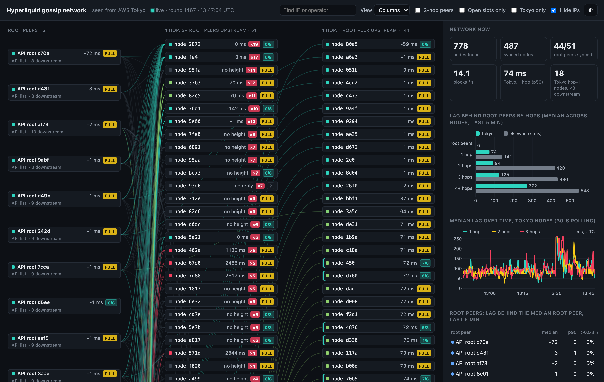

# How peer choice affects a Hyperliquid node's latency

Author: Dean N.
Date: 2026-11-13

In article 001 we ran our own non-validating Hyperliquid node and compared it with the public data feed. The hardest part of that work was getting the node connected. On the default peer settings it took 49 minutes to catch up, and most of its 174 connection attempts were answered with `Peer full`. In the end we pinned it to one peer from the README's list, without knowing whether that was a good choice or a lucky one.

This time we looked at the peering itself. We wrote a small crawler for the gossip network, measured how far behind the root peers each node we could reach was running, and then started three identical nodes with different peer settings to see how much the choice matters in practice. Afterwards we turned the crawler into an internal dashboard, which we describe at the end.

## Key takeaways

- **Default settings:** a node on the README's defaults needed 45 minutes just to get a peer, and it never caught up during the test.
- **Hops:** in Tokyo, every hop away from a root peer added roughly 70 to 150 ms of lag at the median.
- **Root peers:** the 26 root peers returned by the API ran a median 73 ms ahead of the 25 in the README's community list.
- **Picked peers:** with peers chosen from our measurements, the node ran 69 ms behind the root peers at the median and beat the public feed on BTC trades at the 95th percentile, 334 ms against 525 ms. A node pinned to a random open peer ran about half a second behind.

## 1. How a node finds its peers

A non-validating node starts from a list of seed peers, `root_node_ips` in `override_gossip_config.json`. It asks each one for its status on port 4002 and tries to open a block stream on port 4001. A peer only serves a limited number of nodes, and when it has no free slot it replies `Peer full`. If `try_new_peers` is on, the node then asks that peer which nodes it is streaming to and tries those next. It keeps walking down the tree this way until a peer accepts it.

Our crawler does the same walk, using two requests on port 4002 (described in the appendix). We started it from all 51 official root peers: the 26 the API returns for `gossipRootIps` and the 25 in the README's community table. It found 775 nodes. Almost every root peer was already full. 44 of the 45 that answered were serving 7 or more nodes, and 8 seems to be the limit. Two thirds of the network, 516 nodes, sits two or more hops below a root peer, and three quarters of the nodes below the root peers stream from a single upstream peer.

Every block a node applies has been forwarded by each node above it, so the next question was how much each hop costs.

## 2. How much each hop costs

To measure lag, we asked every synced node for its block height at the same moment, 60 times over two minutes, and compared each answer with the median root peer. The chain makes 14 blocks a second, so one block behind is about 71 ms. The appendix has the details.

*Figure 1. Median lag behind the root peers' block height, by hops from a root peer. Tokyo nodes are those our machine reached in under 5 ms. Source: our crawl and 60 rounds of height queries, 06:03 to 06:05 UTC on 2026-11-13; 514 synced nodes.*

In Tokyo, the median node one hop down was 67 ms behind the root peers, two hops down 144 ms and three hops down 290 ms. Outside Tokyo the same positions were 300 to 900 ms behind. Location alone is not enough, though. A Tokyo node three hops down (290 ms) was almost as late as a node outside Tokyo one hop down (337 ms).

*Figure 2. Median and 75th percentile lag behind the root peers for Tokyo nodes two or more hops from a root peer, by number of upstream peers. Source: as Figure 1; 163 nodes.*

Deeper nodes did better when they had more than one upstream peer, since a node applies whichever copy of a block arrives first. Among Tokyo nodes two or more hops down, the slowest quarter was more than 789 ms behind with one upstream peer, compared with 236 ms for nodes with three or more.

*Figure 3. Median lag of each root peer behind the median root peer, by the official list it comes from. Hollow markers fell more than 0.5 s behind in at least 10% of samples. Source: height queries every ~3 seconds from three machines in Tokyo, 08:22 to 08:55 UTC on 2026-11-13, about 2,000 samples per root peer; 44 of the 51 root peers answered throughout.*

The root peers are not equally fast either. Over half an hour of sampling from three machines, the API's root peers ran a median 3 ms ahead of the median root peer, while the README's community root peers ran 70 ms behind. Four root peers, one from the API list and three from the README, were more than half a second behind in 20 to 34% of samples. Any node below one of them inherits that delay.

## 3. What went wrong when we tried it

Before the side-by-side test, we ran the node from article 001 a few times on the morning of 2026-11-13. Three things went wrong, and each one changed how we picked peers.

**A peer that was too slow.** We built a list from the crawl, with the root peers first and then Tokyo nodes one hop down that had free slots and low lag, and turned `try_new_peers` off. The node got the chain state on its fourth attempt, attached to one of our picks and caught up about 12 minutes after start. Three minutes later it started falling behind. The peer was at the chain tip and looked fine from the outside, but it was sending us only 0.25 MB/s, while a live stream needs about 1.5 to 2 MB/s. Our node was applying about 2 blocks a second against the chain's 14.

We restarted without that peer. After 11 more attempts the node attached to another pick that sent 1.86 MB/s, and it caught up nine minutes after the restart. A peer's upload rate does not show up in its status, only in the bytes arriving on the stream. The node's own log did not flag it either: from 06:21 to 06:25, while the node fell further behind, it logged nothing but applied blocks. Its warning that the gossip stream "fell behind, dropped oldest messages" appeared only while it was catching up. So for the side-by-side test we added a watchdog that drops a peer sending too little while the node falls behind.

*Figure 4. Our node's lag behind the root peers' block height, sampled about every 3 seconds: with the slow upstream peer from 06:19 UTC and with its replacement from 06:34 UTC on 2026-11-13. Source: our height queries from the node's machine.*

**The root peer above us.** With the second peer, our node ran 69 ms behind the root peers at the median. Its stream peer was 70 ms behind, and the root peer above that one, run by B-Harvest, was about 60 ms behind the median root peer. Most of our lag came from the root peer at the top, not from the hops below it. That is why we rank candidates by their own measured lag rather than by hops.

*Figure 5. The root peers above the nine peers we selected (operators as listed in the node README; nodes each serves from our crawl), each selected peer's median lag behind the root peers, and the three peers our node used in the morning run (06:34 to 06:49 UTC). Source: our crawl at 06:03 UTC, our height queries and our node's log, 2026-11-13.*

**The default settings.** In a trial on the official seed list with `try_new_peers` on, as the README suggests, the node took 35 attempts to get a peer and got within about nine minutes of the chain. Then it lost that peer and stopped applying blocks. After 31 minutes and 168 attempts, 129 of them answered `Peer full`, it still had not caught up.

## 4. Three setups side by side

To compare the setups properly, we started three identical machines (AWS `r6i.4xlarge`, same zone in Tokyo) at the same time, 07:50 UTC, each with different peer settings. We gave them 30 minutes to sync and then measured all three over the same 34 minutes:

- **README default:** the 26 peers from `gossipRootIps`, with `try_new_peers` on.
- **One pinned peer:** a single open Tokyo node one or two hops below a root peer, picked at random from the 68 our crawl found. This is roughly what you get by picking a peer off an explorer.
- **Our list and watchdog:** the 51 root peers, then the 12 candidates with the lowest measured lag from a fresh crawl, with `try_new_peers` off. The watchdog removes the current peer and restarts the node if the node is more than 2 seconds behind while the stream brings less than 1 MB/s for 30 seconds.

*Figure 6. Minutes from starting the node until its trade stream was less than one second behind, for three machines started together at 07:50 UTC on 2026-11-13. Source: the nodes' own output and logs.*

The pinned node was live after 6.9 minutes and ours after 7.5. The default node did not get a peer until 45 minutes in, after 116 attempts, and never caught up. By the end of the run it had made 235 attempts, 181 of them answered `Peer full` and 51 timed out.

*Figure 7. Median and 95th percentile lag behind the root peers' block height, 08:22 to 08:55 UTC on 2026-11-13, about 670 samples per machine. Source: height queries from each machine to its own node and the 51 root peers.*

The other two nodes stayed connected, but their lag was very different. The pinned peer was two hops down, which put that node three hops below a root peer. It ran 495 ms behind the root peers at the median and 2 seconds at the 95th percentile, and it was more than half a second behind in 44% of samples. The node on our list sat two hops down and ran 69 ms behind at the median and 142 ms at the 95th percentile. It was never more than half a second behind, and the watchdog never had to drop a peer.

*Figure 8. Share of matched BTC trades that reached the public feed first or the node first, and by how much, 08:22 to 08:55 UTC on 2026-11-13; 14,536 matched trades for our setup, 14,530 for the pinned peer. Source: each machine's node and a public-feed collector on the same machine and clock.*

As in article 001, we also ran a public-feed collector on each machine and matched BTC trades between the node and the feed. Measured from the exchange timestamp, the node on our list was level with the public feed at the median (259 ms against 255 ms) and well ahead in the tail: 334 against 525 ms at the 95th percentile and 405 against 680 ms at the 99th. It received the trade first 43% of the time. The pinned node was first on 3% of trades, and the default node, which never caught up, on none.

This was a single 34-minute run with one machine per setup, and the pinned peer was a random draw, so a different draw could have landed closer to a root peer.

## 5. The dashboard we use now

Running the crawler by hand and reading its output was fine for one article but not for day-to-day work, so after the test we put it behind a small internal dashboard. It runs on a small machine in Tokyo, crawls the network every two minutes and asks every synced node for its block height every five seconds, using the same lag method as above.

*Figure 9. Our internal gossip dashboard, with IP addresses hidden. Root peers are on the left, then the nodes streaming from two or more root peers (with how many) and from just one. Each card shows the node's median lag behind the root peers over the last five minutes and whether it still has free slots, and each link is coloured by the lag of the node it feeds. Nodes two or more hops down are hidden unless switched on. Screenshot taken at 13:47 UTC on 2026-11-13.*

Hovering over a node highlights its path up to the root peers and the nodes it serves; clicking it shows its lag over the last few minutes. A side panel lists the Tokyo nodes one hop below a root peer that still have free slots, ranked by their lag over the last five minutes, and can write them out as an `override_gossip_config.json`. We use it to pick peers before we start or restart a node, and to check whether the root peer above our node has started to fall behind.

## Appendix: the gossip messages and how we measured lag

The gossip protocol is not documented, so we captured our node's traffic with `tcpdump` while it was looking for peers and matched the bytes against the message names in its log. Each message is a 4-byte big-endian length, a flag byte and a compact binary payload. We used two requests on port 4002. `0x01` (`Peers`) returns the nodes a peer is currently streaming to, as IP addresses with two flag bytes each. `0x02` (`GossipStatus`) returns, among other fields, the peer's latest block height, or nothing while it is still syncing. Following `Peers` from the root peers gives each node's hop count, and counting how many nodes list a node gives its number of upstream peers. In the node's log the same things appear as `verified_node_ips` (a peer's `Peers` list), `latest_height` (in `GossipStatus`), `Peer full` (the reply when a peer has no free slot) and `abci stream` (the block stream on port 4001).

For lag, each round queries all nodes at once. We shift each reported height to the round's median query time using the chain's measured rate of 14.0 blocks a second, then compare it with the median height of the root peers. Nodes that are still syncing, and a few that reported heights from another chain, are left out.

## Our setup

- **Machines:** AWS `r6i.4xlarge` in Tokyo (ap-northeast-1, zone ID apne1-az1), 16 vCPU, 128 GiB of memory, gp3 volume, Ubuntu 24.04. The node from article 001 for the crawl and the morning runs, and three fresh machines for the side-by-side run.
- **Node:** `hl-node` under `hl-visor`, run with `--write-trades --stream-with-block-info --disable-output-file-buffering`.
- **Crawler, peer picker and watchdog:** our own Python, run on each node's machine.
- **Dashboard:** the same crawler and height sampling in a small web service with a browser front end, on an AWS `t3.small` in Tokyo.
- **Public feed:** the same collector as in article 001, subscribed to BTC trades on the public WebSocket API, on each node's machine and clock.
