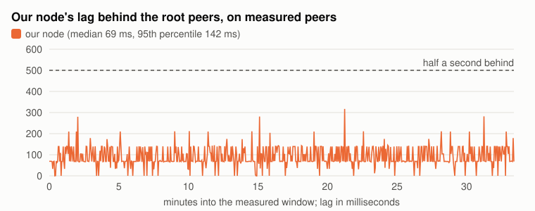
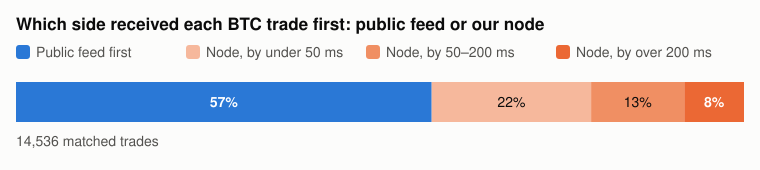

# How peer choice affects a Hyperliquid node's latency

Author: Dean N.
Date: 2026-11-13

In article 001 we ran our own non-validator Hyperliquid node and compared it with the public data feed. The hardest part of that work was getting the node connected. Left to find peers on its own, from the API's root peer list with `try_new_peers` on, it made 174 connection attempts in 27 minutes, most of them answered with `Peer full`, and it took 49 minutes in all to catch up. In the end we pinned it to one peer from the README's list, without knowing whether that was a good choice or a lucky one.

This time we looked at the peering itself. We wrote a small crawler for the gossip network, measured how far behind the root peers each node we could reach was running, and then ran our node on peers picked from those measurements. Afterwards we turned the crawler into an internal dashboard, which we describe at the end.

## Key takeaways

- **Hops:** in Tokyo, every hop away from a root peer added roughly 70 to 150 ms of lag at the median.
- **Root peers:** the Foundation nodes ran a median 73 ms ahead of the root peers run by validators.
- **Measured peers:** with peers chosen from our measurements, the node ran 69 ms behind the root peers at the median and beat the public feed on BTC trades at the 95th percentile, 334 ms against 525 ms.

## 1. How a node finds its peers

Hyperliquid's network has validators, which run consensus, and non-validator nodes, which follow the chain. Validators keep other nodes at a distance: each connects directly to at most two non-validator nodes of its own, its sentry nodes. Non-validators start from published root peers instead: Foundation nodes, which the API returns for `gossipRootIps`, and nodes run by validators, listed in the node README. Every other non-validator node, like ours, gets its blocks through them.

A non-validator node starts from a list of seed peers, `root_node_ips` in `override_gossip_config.json`. It asks each one for its status on port 4002 and tries to open a block stream on port 4001. We call the peer a node streams blocks from its parent peer, and the nodes it streams to its child peers, as the node's own status files do. A peer only takes a limited number of child peers, and when it has no free slot it replies `Peer full`. If `try_new_peers` is on, the node then asks that peer for its child peers and tries those next. It keeps walking down the tree this way until a peer accepts it.

Our crawler does the same walk, using two requests on port 4002 (described in the appendix). We started it from all 51 published root peers: the 26 Foundation nodes from the API and the 25 root peers in the community table of the node README, which pairs each IP with an operator. 21 of those 25 belong to operators that are current validators; we call them Validator root peers. The other 4 belong to two operators that are no longer validators. It found 775 nodes. Almost every root peer was already full. 44 of the 45 that answered had 7 or more child peers. Eight looks like the default limit: it was the most common number of child peers after zero, with 149 of the 650 nodes that answered, but 50 nodes had more, mostly 9 to 21 and two with 100, so the limit can be raised. Two thirds of the network, 516 nodes, sits two or more hops below a root peer, and three quarters of the nodes below the root peers have a single parent peer.

Every block a node applies has been forwarded by each node above it, so the next question was how much each hop costs.

## 2. How much each hop costs

To measure lag, we asked every synced node for its block height at the same moment, 60 times over two minutes, and compared each answer with the median root peer. The chain makes 14 blocks a second, so one block behind is about 71 ms. The appendix has the details.

*Figure 1. Median lag behind the root peers' block height of nodes in Tokyo (those our machine reached in under 5 ms), by hops from a root peer. Source: our crawl and 60 rounds of height queries, 06:03 to 06:05 UTC on 2026-11-13; 262 synced nodes in Tokyo.*

In Tokyo, the median node one hop down was 67 ms behind the root peers, two hops down 144 ms and three hops down 290 ms. We leave nodes outside Tokyo out of these numbers: distance alone adds tens to hundreds of milliseconds for them, whatever their peers.

*Figure 2. Median and 75th percentile lag behind the root peers for Tokyo nodes two or more hops from a root peer, by number of parent peers. Source: as Figure 1; 163 nodes.*

Deeper nodes did better when they had more than one parent peer, since a node applies whichever copy of a block arrives first. Among Tokyo nodes two or more hops down, the slowest quarter was more than 789 ms behind with one parent peer, compared with 236 ms for nodes with three or more.

*Figure 3. Median lag of each root peer behind the median root peer: Foundation nodes, Validator root peers, and the listed nodes whose operator is no longer a validator. Hollow markers fell more than 0.5 s behind in at least 10% of samples. Source: height queries every ~3 seconds from three machines in Tokyo, 08:22 to 08:55 UTC on 2026-11-13, about 2,000 samples per root peer; 44 of the 51 root peers answered throughout.*

The root peers are not equally fast either. Over half an hour of sampling from three machines, the Foundation nodes ran a median 3 ms ahead of the median root peer, while the Validator root peers ran 70 ms behind. Four root peers, one Foundation node and three Validator root peers, were more than half a second behind in 20 to 34% of samples. Any node below one of them inherits that delay.

## 3. What measured peers get you

To see what this is worth, we started a fresh machine (AWS `r6i.4xlarge` in Tokyo) at 07:50 UTC with a peer list built from a crawl taken two minutes earlier: the 51 root peers first, then the 12 Tokyo nodes with the lowest measured lag, and `try_new_peers` off. Alongside it ran a watchdog that drops the current peer and restarts the node if the node is more than 2 seconds behind while the stream brings in less than 1 MB/s for 30 seconds. We added it after a test run that morning, when a peer at the chain tip sent our node only 0.25 MB/s, about a sixth of what a live stream needs, and nothing in the peer's status or our node's log showed it. We gave the node 30 minutes to sync and then measured for 34 minutes.

The node was live 7.5 minutes after start, streaming from a node one hop below a root peer, which put it two hops down. Through the window it ran 69 ms behind the root peers at the median and 142 ms at the 95th percentile, and it was never more than half a second behind. The watchdog never had to step in.

*Figure 4. Our node's lag behind the root peers' block height in each sampling round, about every 3 seconds, 08:22 to 08:55 UTC on 2026-11-13. Source: height queries from the node's machine to the node and the 51 root peers.*

As in article 001, a public-feed collector ran on the same machine, and we matched BTC trades between the node and the feed. Measured from the exchange timestamp, the node was level with the public feed at the median (259 ms against 255 ms) and well ahead in the tail: 334 against 525 ms at the 95th percentile and 405 against 680 ms at the 99th. It received the trade first 43% of the time, 8% of the time by more than 200 ms.

*Figure 5. Share of matched BTC trades that reached the public feed first or our node first, and by how much, 08:22 to 08:55 UTC on 2026-11-13; 14,536 matched trades. Source: the node and a public-feed collector on the same machine and clock.*

Leaving the node to find peers itself does not work as well. A second machine, started at the same moment with the API's 26 root peers and `try_new_peers` on, collected `Peer full` answers for 45 minutes before any peer accepted it, and it never caught up.

This was one run of 34 minutes on one machine, in a quiet market.

## 4. The dashboard we use now

Running the crawler by hand was fine for one article but not for day-to-day work, so after the test we turned it into an internal tool for picking peers. It runs on a small machine in Tokyo, crawls the network every two minutes, asks every node for its block height every ten seconds and keeps the results for a week.

*Figure 6. The main page of our internal tool: Tokyo nodes up to two hops below a root peer, ranked by how far they run behind the fastest root peer, and the `override_gossip_config.json` it writes from them. Screenshot taken at 17:18 UTC on 2026-11-14.*

The main page ranks candidate peers and writes the config file. A second page looks up any node, ours included: where it sits, its path up to a root peer, its lag over the last 24 hours and how far it trails the best peer available. The other pages show each root peer's lag through the day and the network as a whole.

The tool measures in two ways that differ from the rest of this article. It counts lag from the fastest root peer rather than the median one, so its numbers run about one block higher and never drop below zero. It also corrects each answer for the time it took to reach our machine, which matters only for nodes outside Tokyo. What it cannot see is a peer's upload rate, so we still watch the incoming rate on our node and drop a peer that sends too little.

## Appendix: the gossip messages and how we measured lag

The gossip protocol is not documented, so we captured our node's traffic with `tcpdump` while it was looking for peers and matched the bytes against the message names in its log. Each message is a 4-byte big-endian length, a flag byte and a compact binary payload. We used two requests on port 4002. `0x01` (`Peers`) returns the nodes a peer is currently streaming to, as IP addresses with two flag bytes each. `0x02` (`GossipStatus`) returns, among other fields, the peer's latest block height, or nothing while it is still syncing. Following `Peers` from the root peers gives each node's hop count, and counting how many nodes list a node gives its number of parent peers. In the node's log the same things appear as `verified_node_ips` (a peer's `Peers` list), `latest_height` (in `GossipStatus`), `Peer full` (the reply when a peer has no free slot) and `abci stream` (the block stream on port 4001).

For lag, each round queries all nodes at once. We shift each reported height to the round's median query time using the chain's measured rate of 14.0 blocks a second, then compare it with the median height of the root peers. Nodes that are still syncing, and a few that reported heights from another chain, are left out.

## Our setup

- **Machines:** AWS `r6i.4xlarge` in Tokyo (ap-northeast-1, zone ID apne1-az1), 16 vCPU, 128 GiB of memory, gp3 volume, Ubuntu 24.04. The node from article 001 for the crawl, and fresh machines for the measured run.
- **Node:** `hl-node` under `hl-visor`, run with `--write-trades --stream-with-block-info --disable-output-file-buffering`.
- **Crawler, peer picker and watchdog:** our own Python, run on each node's machine.
- **Dashboard:** the same crawler and height sampling in a small web service with a browser front end, on an AWS `t3.small` in Tokyo.
- **Public feed:** the same collector as in article 001, subscribed to BTC trades on the public WebSocket API, on each node's machine and clock.
