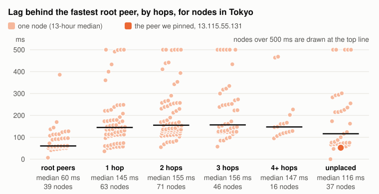
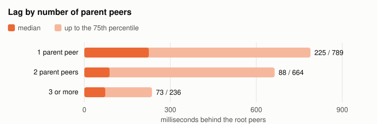
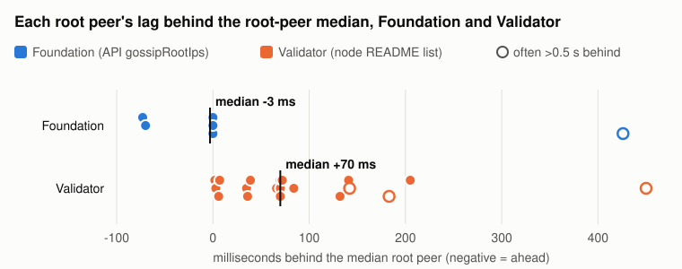
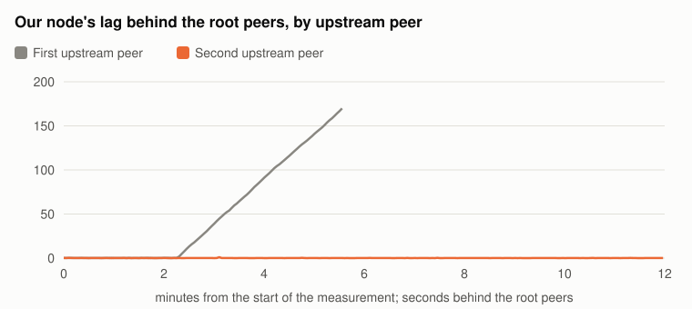
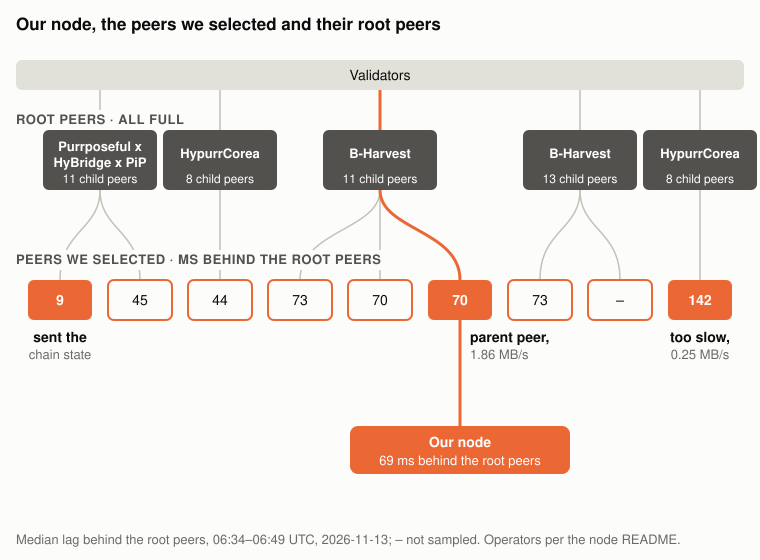
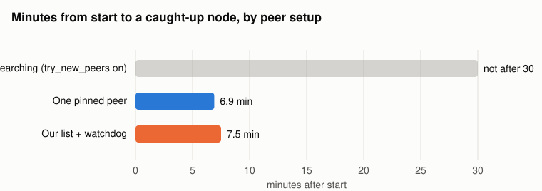
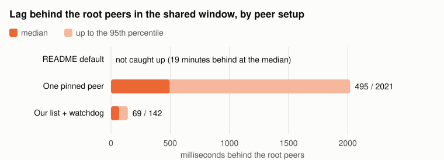
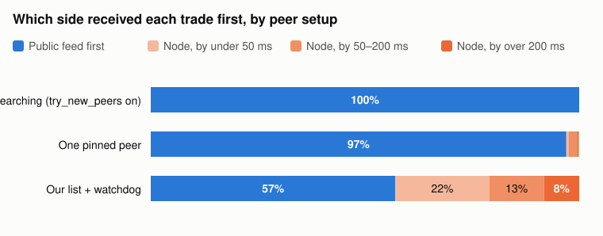

# Picking peers for a Hyperliquid node: what each choice costs, measured

Author: Dean N.
Date: 2026-11-13

A Hyperliquid node hears each block from the peer it streams from, so where it sits in the gossip network sets how late it is. Network explorers show who is connected to whom; they do not show what each position costs. We crawled the network from our node in Tokyo, measured how far behind the root peers every node runs, ran our node on different peer setups, and turned what we learned into two scripts you can run on your own node.

## Key takeaways

- **Every hop costs time:** in Tokyo, the median node is 67 ms behind the root peers one hop down, 144 ms two hops down and 290 ms three hops down.
- **Root peers are not equal:** the 26 root peers returned by the API ran a median 73 ms ahead of the 25 listed in the node README, and four root peers fell more than half a second behind in 20–34% of samples.
- **The default setup barely works:** started side by side with two other setups, a node on the README defaults needed 45 minutes and 116 attempts to get a peer and never caught up; the other two were live in 7 to 8 minutes.
- **Which peer you pin matters more than pinning:** over the same 34 minutes, a randomly chosen open peer left the node 495 ms behind the root peers at the median and 2 seconds at the 95th percentile; peers picked from measurements kept it at 69 and 142 ms.
- **Measured peers beat the public feed's tail:** on BTC trades our node matched the public feed at the median (259 against 255 ms) and beat it at the 95th percentile (334 against 525 ms), receiving the trade first 43% of the time; the pinned node did so 3% of the time.
- **A healthy-looking peer can starve you:** one peer we used was at the chain tip but sent only 0.25 MB/s, while a live stream needs about 1.5 to 2 MB/s.

## 1. What decides how late your node is

A non-validating node reads a list of seed peers (`root_node_ips`) from `override_gossip_config.json`, asks each for its status on port 4002 and opens a block stream on port 4001. Every block it applies has passed through each node between it and the validators, so each hop adds a forwarding delay, and the root peer at the top adds its own.

When a peer has no free slot it answers `Peer full`. With `try_new_peers` on, the node then takes that peer's own downstream peers as its next candidates and walks down until somebody accepts it. The root peers are almost always full: 44 of the 45 that answered our crawl were serving 7 or more nodes, and 8 looks like the default limit. So a node on the default settings ends up wherever the walk stops. Of the 775 nodes we found, 516 are two or more hops below a root peer, and three quarters of the nodes below the root peers have a single upstream peer.

## 2. What each position costs

To price these positions we crawled the network from our node's machine in AWS Tokyo, starting from the 51 official root peers, and queried every synced node's block height at the same moment, repeatedly. A node's lag is how many blocks it trails the median root peer, at 71 ms per block (method in the appendix).

*Figure 1. Median lag behind the root peers' block height, by hops from a root peer. Tokyo nodes are those our machine reached in under 5 ms. Source: our crawl and 60 rounds of height queries, 06:03 to 06:05 UTC on 2026-11-13; 514 synced nodes.*

In Tokyo, each hop adds roughly 70 to 150 ms at the median. Outside Tokyo the same positions cost 300 to 900 ms. A Tokyo node three hops down (290 ms) is nearly as late as a node outside Tokyo one hop down (337 ms), so moving your machine to Tokyo is only half of it.

*Figure 2. Median and 75th percentile lag behind the root peers for Tokyo nodes two or more hops from a root peer, by number of upstream peers. Source: as Figure 1; 163 nodes.*

The slow tail belongs to nodes with a single upstream peer. Among Tokyo nodes two or more hops down, the 75th percentile is 789 ms with one upstream peer and 236 ms with three or more: a node that hears each block from several directions takes whichever copy arrives first.

*Figure 3. Median lag of each root peer behind the median root peer, by the official list it comes from. Hollow markers fell more than 0.5 s behind in at least 10% of samples. Source: height queries every ~3 seconds from three machines in Tokyo, 08:22 to 08:55 UTC on 2026-11-13, about 2,000 samples per root peer; 44 of the 51 root peers answered throughout.*

The top of the tree is uneven too. The root peers returned by the API's `gossipRootIps` request ran a median 3 ms ahead of the median root peer, and their 95th percentile never trailed it. The community root peers listed in the README ran a median 70 ms behind, with a 95th percentile of 121 ms. Four root peers, one from the API list and three from the README, were more than half a second behind in 20–34% of samples. Which root peer sits above you matters as much as how far below it you are.

## 3. Three traps

**The default walk.** On the official seed list with `try_new_peers` on, as the README suggests, a fresh node spends its time collecting `Peer full` answers. In the side-by-side run below it made 116 attempts in 45 minutes before any peer accepted it, 235 attempts in all (181 `Peer full`, 51 timeouts), and never caught up. An earlier run the same morning lost its first peer after nine minutes and also never caught up, and on 2026-10-29 the same setup went 27 minutes without even receiving the chain state.

**The peer that cannot keep up.** With our own list, the node attached to a selected peer that was itself at the chain tip, and fell behind three minutes after catching up. That peer sent us 0.25 MB/s; a live stream needs about 1.5 to 2 MB/s, and our node applied about 2 blocks a second against the chain's 14. Nothing in a peer's status or position shows this. You only see it in the incoming byte rate.

*Figure 4. Our node's lag behind the root peers' block height, sampled about every 3 seconds: with the slow upstream peer from 06:19 UTC and with its replacement from 06:34 UTC on 2026-11-13. Source: our height queries from the node's machine.*

**The slow root.** A good peer one hop down is still only as early as its root peer. In our morning run, our stream peer sat under B-Harvest's root peer, which ran about 60 ms behind the median; our node ran 69 ms behind, its stream peer 70 ms, so the whole block of lag came from the root peer above.

*Figure 5. The root peers above the nine peers we selected (operators as listed in the node README; nodes each serves from our crawl), each selected peer's median lag behind the root peers, and the three peers our node used in the morning run (06:34 to 06:49 UTC). Source: our crawl at 06:03 UTC, our height queries and our node's log, 2026-11-13.*

## 4. Default, pinned and measured, side by side

To test this, we started three identical machines (AWS `r6i.4xlarge`, same zone in Tokyo) at the same moment, 07:50 UTC, each with a different peer setup, and measured all three over the same 34 minutes once they had had 30 minutes to sync:

- **README default:** the 26 peers from `gossipRootIps`, `try_new_peers` on.
- **One pinned peer:** a single open Tokyo node one or two hops below a root peer, chosen at random from the 68 our crawl found, the way an operator might pick one from an explorer.
- **Our list and watchdog:** `pick_peers.py` (below), which listed the 51 root peers and the 12 best candidates by measured lag, and `peer_watchdog.py`.

*Figure 6. Minutes from starting the node until its trade stream was less than one second behind, for three machines started together at 07:50 UTC on 2026-11-13. Source: the nodes' own output and logs.*

The pinned node and ours were live 6.9 and 7.5 minutes after start. The default node was still looking for a peer 45 minutes after start.

*Figure 7. Median and 95th percentile lag behind the root peers' block height, 08:22 to 08:55 UTC on 2026-11-13, about 670 samples per machine. Source: height queries from each machine to its own node and the 51 root peers.*

Being connected is not the same as being early. The pinned peer put that node three hops below a root peer, and it ran 495 ms behind the root peers at the median, 2 seconds at the 95th percentile, and more than half a second behind in 44% of samples. With the measured list the node sat two hops down, 69 ms behind at the median and 142 ms at the 95th percentile, and never more than half a second behind. The watchdog did not need to step in: the first peer the node took kept up.

*Figure 8. Share of matched BTC trades that reached the public feed first or the node first, and by how much, 08:22 to 08:55 UTC on 2026-11-13; 14,536 matched trades for our setup, 14,530 for the pinned peer. Source: each machine's node and a public-feed collector on the same machine and clock.*

Against the public feed, the node on measured peers matched it at the median, 259 against 255 ms on BTC trades, and beat it in the tail: 334 against 525 ms at the 95th percentile and 405 against 680 ms at the 99th. It had the trade first 43% of the time, 8% of the time by more than 200 ms. The node on the pinned peer was first on 3% of trades, and the default node, never caught up, on none.

This is one run of 34 minutes with one machine per setup, and the pinned peer was a random draw; another draw could land closer to a root peer. What the run shows is the gap between an unmeasured choice and a measured one, on the same hardware at the same time.

## 5. Do it on your node

Both scripts are in the [`scripts`](scripts) folder next to this article, with the two helpers `pick_peers.py` imports (`crawl_gossip.py`, `sample_status.py`), and need only Python 3 on the node's machine. Copy all four to the same directory.

1. **Pick peers.** `python3 pick_peers.py` collects the root peers (API and README), crawls the network, samples every node's height for a minute and writes `~/override_gossip_config.json`: root peers first, then the best candidates by measured lag, with `try_new_peers` off. Run it on the node's own machine so connect times reflect your location.
2. **Start the node** as usual (`hl-visor run-non-validator ...`). It needs `--stream-with-block-info` and an output such as `--write-trades` for the watchdog to read its lag.
3. **Watch the stream.** `python3 peer_watchdog.py --service <your unit>` checks the incoming rate on the node's block stream every 5 seconds. If the node is more than 2 seconds behind while the stream brings less than 1 MB/s for 30 seconds, it removes that peer from the config and restarts the node, which moves to the next peer in the list.
4. **Re-run the picker** every few hours or after a restart: slots open and close, and root peers drift.

## Appendix: method and the two gossip messages

The gossip messages are not documented, so we recorded our node's traffic while it searched for peers and matched the bytes to the names in its log. Each message is a 4-byte big-endian length, one flag byte and a compact binary payload. On port 4002, request `0x01` (`Peers`) returns the nodes a peer is currently streaming to, each as an IP address and two flag bytes; request `0x02` (`GossipStatus`) returns, among other fields, the peer's latest block height, or nothing while it is syncing. Following `Peers` links from the root peers gives hops; the number of nodes listing a node gives its upstream peers.

For lag, every round queries all target nodes at once; each height is shifted to the round's median query time at the chain's measured rate (14.0 blocks per second); the reference is the median height of the root peers; nodes reporting heights from another chain or still syncing are left out.

## Our setup

- **Machines:** AWS `r6i.4xlarge` in Tokyo (ap-northeast-1, zone ID apne1-az1), 16 vCPU, 128 GiB of memory, gp3 volume, Ubuntu 24.04: our node from our data feed latency article (001) for the crawl and the morning runs, and three fresh machines for the side-by-side run.
- **Node:** `hl-node` under `hl-visor`, run with `--write-trades --stream-with-block-info --disable-output-file-buffering`.
- **Crawler and scripts:** our own Python, on each node's machine.
- **Public feed:** the same collector as in article 001, subscribed to BTC trades on the public WebSocket API, on each node's machine and clock.
